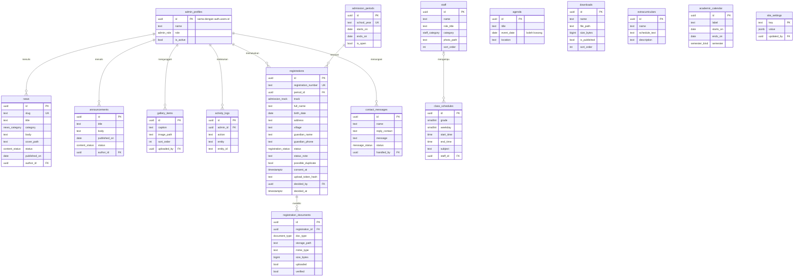

# ERD

Sumber kebenaran skema: `supabase/migrations/0001_init.sql`. Narasi lengkap ada di dokumen PRD, ERD, dan Rencana Backend.

## Bucket storage

| Bucket | Akses | Isi |
|---|---|---|
| media | Baca publik | Sampul berita, galeri, foto guru |
| downloads | Baca publik | PDF unduhan |
| admission | Privat (tautan bertanda tangan 5 menit) | `registrations/{id}/{doc_type}` |
